# AWS Lab Report

## Project: AWS Lambda + DynamoDB + Scheduled S3 Backups

**Approach:** AWS Management Console + Python

------------------------------------------------------------------------

## 1. Architecture Explanation

In this project, we created a serverless data pipeline using AWS
services.

The data flow works in the following way:

1.  First, we fetch 10 sample users from the JSONPlaceholder API.
2.  Lambda Function #1 gets the user data using an HTTP GET request.
3.  The data is stored in the DynamoDB table using the `PutItem`
    operation.
4.  Lambda Function #2 reads all user data from DynamoDB using the
    `Scan` operation.
5.  It converts the data into JSON format.
6.  The JSON backup file is uploaded to a private S3 bucket.
7.  EventBridge Scheduler automatically runs Lambda #2 every 2 minutes.
8.  CloudWatch monitors the Lambda functions using logs and metrics.

**Architecture flow:**

``` 
JSONPlaceholder API
        |
        v
Lambda #1: import-jsonplaceholder-users
        |
        | PutItem
        v
DynamoDB: jsonplaceholder-users
        |
        | Scan
        v
Lambda #2: export-dynamodb-to-s3 <--- EventBridge Scheduler
        |                              rate(2 minutes)
        | PutObject
        v
Private Amazon S3 Bucket
        |
        v
Timestamped JSON backup files

Both Lambda functions ---> CloudWatch Logs and Metrics
```

------------------------------------------------------------------------

## 2. DynamoDB Table

**Table Name:** `jsonplaceholder-users`\
**Partition Key:** `id`\
**Data Type:** Number

DynamoDB is a NoSQL database service. In this project, we use DynamoDB
to store user information such as ID, name, email, address, and company.

**Screenshot 2: DynamoDB table showing `id` as Number**

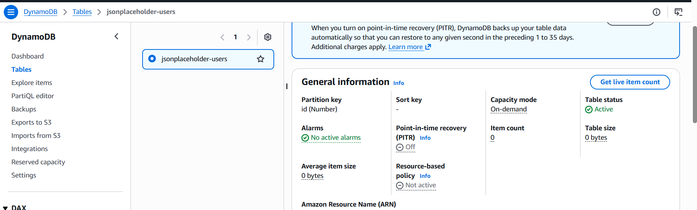

------------------------------------------------------------------------

## 3. Lambda #1 -- Import Users

**Function Name:** `import-jsonplaceholder-users`

Lambda Function #1 fetches 10 sample users from the JSONPlaceholder API.

It uses Python and Boto3 to store the user information in DynamoDB. We
use the `PutItem` operation to insert user records into the table


**Screenshot 3: Successful Lambda #1 execution**

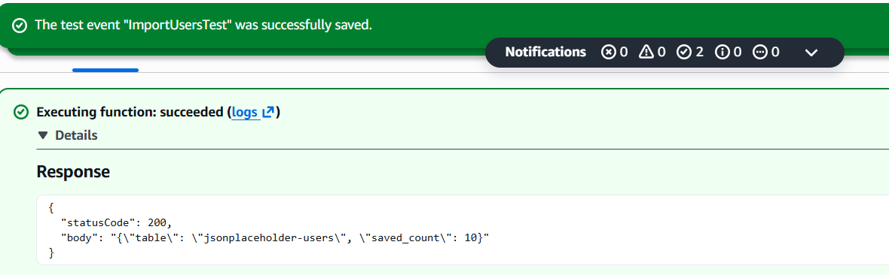

**Screenshot 4: User records in DynamoDB**

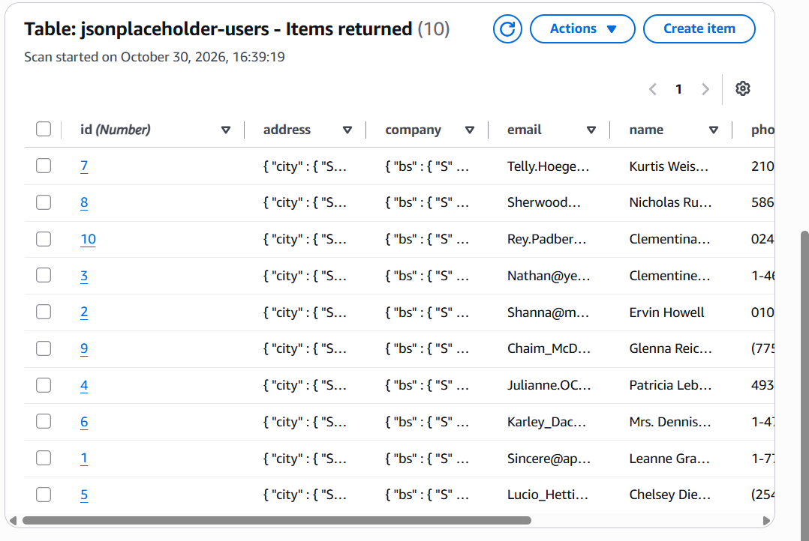

------------------------------------------------------------------------

## 4. Lambda #2 -- Export Data to S3

**Function Name:** `export-dynamodb-to-s3`

Lambda Function #2 reads all user records from DynamoDB using the `Scan`
operation.

It converts the records into JSON format and uploads the backup file to
the S3 bucket.

Each execution creates a new JSON file with a unique timestamp and
request ID. This prevents an earlier backup file from being overwritten.
 

**Screenshot 5: Successful Lambda #2 execution**

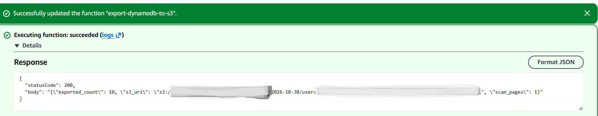

**Screenshot 6: JSON backup file inside the S3 bucket**

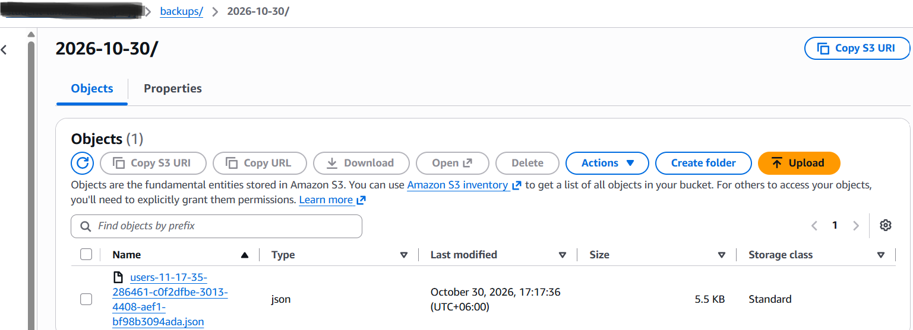

------------------------------------------------------------------------

## 5. IAM Permissions Explanation

IAM controls which AWS services a Lambda function can access.

### Lambda #1 -- `dynamodb:PutItem`

Lambda #1 needs `dynamodb:PutItem` permission because it inserts user
data into the DynamoDB table.

### Lambda #2 -- `dynamodb:Scan` and `s3:PutObject`

-   `dynamodb:Scan`: Allows Lambda #2 to read all user records from
    DynamoDB.
-   `s3:PutObject`: Allows Lambda #2 to upload JSON backup files into
    the S3 bucket.

We use specific permissions instead of `AdministratorAccess` to follow
the principle of least privilege. This means each function gets only the
permissions it needs.

------------------------------------------------------------------------

## 6. EventBridge Scheduler

**Schedule Name:** `dynamodb-backup-every-2min`\
**Schedule Expression:** `rate(2 minutes)`

EventBridge Scheduler automatically invokes Lambda #2 every 2 minutes.
This means we do not need to run the backup function manually every
time.

**Screenshot 7: EventBridge Scheduler showing `rate(2 minutes)`**

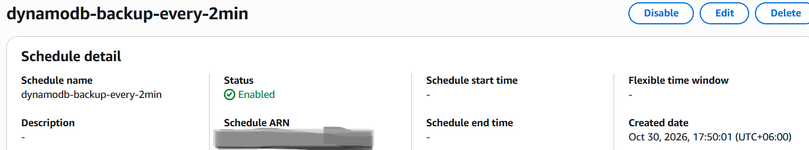

------------------------------------------------------------------------

## 7. Automatic Backup Verification

After enabling EventBridge Scheduler, Lambda #2 runs automatically every
2 minutes.

Each successful execution creates a new JSON backup file in the S3
bucket. I verified that multiple backup files were created
automatically.

**Screenshot 8: At least two automatically generated JSON files**

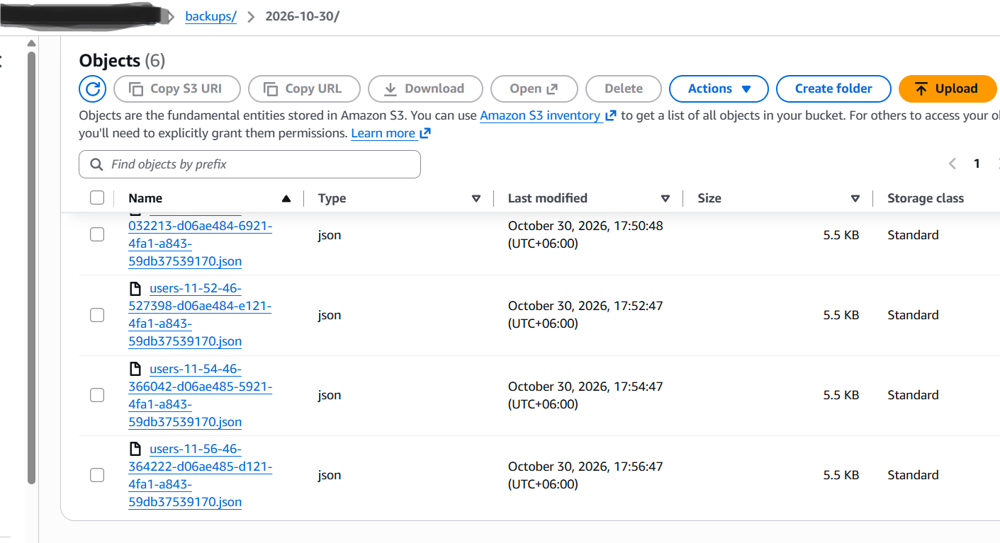

------------------------------------------------------------------------

## 8. CloudWatch Monitoring

Amazon CloudWatch is used to monitor the Lambda functions.

CloudWatch provides two important features:

-   **Logs:** Show detailed messages about Lambda execution, such as
    saved users and exported records.
-   **Metrics:** Show the number of invocations, errors, and execution
    duration.

These features help us monitor the performance of the functions and
identify errors.

**Screenshot 9: CloudWatch Logs**

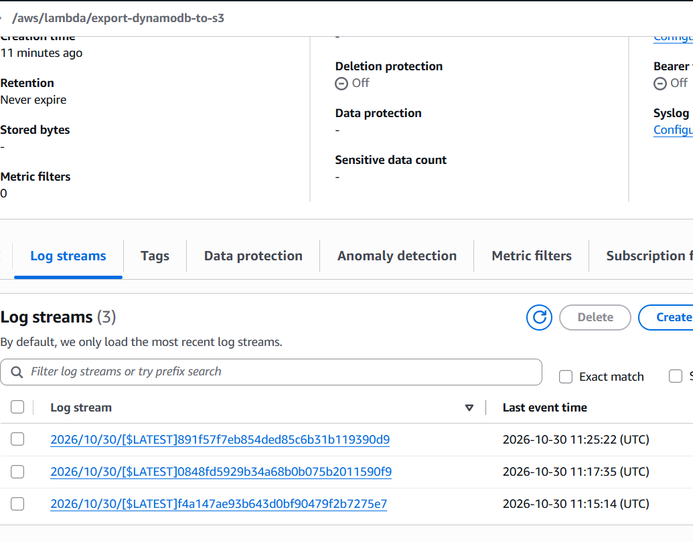

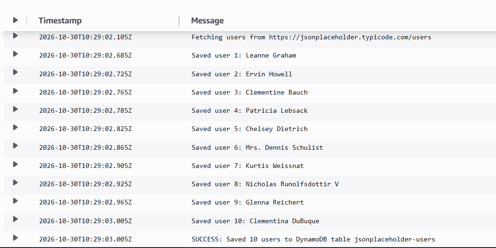

**Screenshot 10: Lambda Metrics Graph**

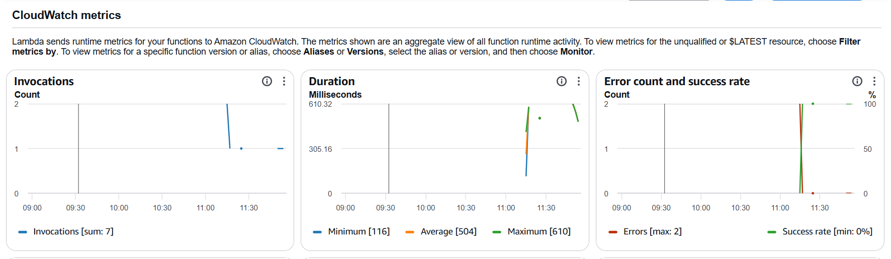

------------------------------------------------------------------------

## 9. Cleanup and Resource Management

After completing the project, I disabled or deleted the EventBridge
Scheduler to stop automatic backup executions.

This helps prevent unnecessary AWS resource usage and additional
charges.

**Screenshot 11: Scheduler disabled or deleted**


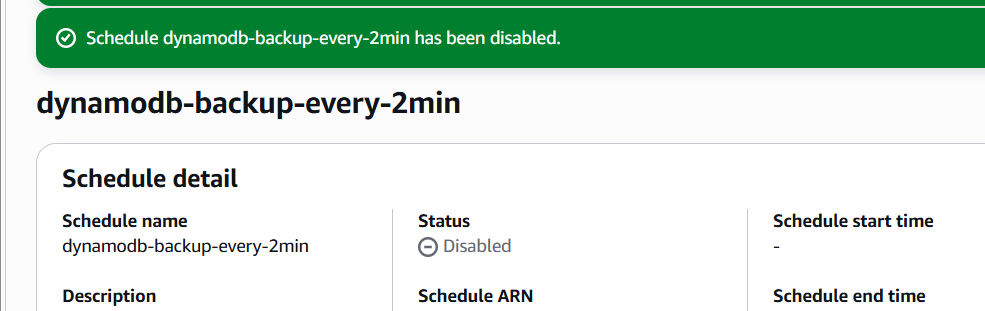

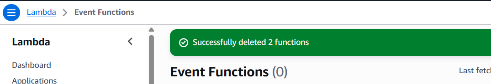

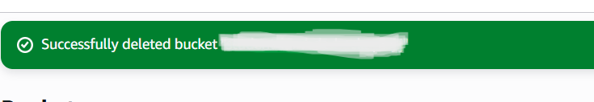

------------------------------------------------------------------------

# 10. Answers to the Six Assignment Questions

### Question 1: What is the difference between Lambda's execution role and Scheduler's execution role?

**Answer:**

Lambda's execution role gives permission to the Lambda function to
access AWS services like DynamoDB and S3.

Scheduler's execution role allows EventBridge Scheduler to invoke a
specific Lambda function.

In simple words, Lambda's role controls what the function can do, while
Scheduler's role allows it to start the function.

### Question 2: Why does running Lambda #1 twice not produce 20 DynamoDB users?

**Answer:**

Lambda #1 uses the `PutItem` operation to save users in DynamoDB.

Each user has a unique ID. When Lambda runs again, DynamoDB replaces the
existing item with the same ID instead of creating a new one.

So, running Lambda #1 twice still keeps approximately 10 users in the
table.

### Question 3: Why do Lambda #2 backups have unique timestamps and request IDs?

**Answer:**

Lambda #2 creates a new JSON backup file every time it runs.

Each file contains a unique timestamp and request ID in its filename.

This helps identify different backups and prevents old backup files from
being overwritten.

### Question 4: What is the difference between `print()` logs and `Invocations`/`Errors` metrics?

**Answer:**

`print()` logs show messages from the Python code.

`Invocations` metrics show how many times the Lambda function runs.

`Errors` metrics show how many times the Lambda function fails.

In simple words, logs show what happens inside the function, while
metrics show its execution results.

### Question 5: What would happen if you deleted the DynamoDB table but kept its JSON files in S3? Could the original indexes/configuration be automatically restored from the JSON alone?

**Answer:**

If we delete the DynamoDB table, all its stored data will be removed.

However, the JSON backup files in S3 will still remain safe.

We can use these JSON files to manually restore the user data into a new
DynamoDB table.

But the original table settings, indexes, and configuration cannot be
automatically restored from the JSON files alone.

### Question 6: Why is an export every 2 minutes usually a poor production backup strategy for large DynamoDB tables?

**Answer:**

Taking backups every 2 minutes is not a good strategy for large
production databases because:

1.  It creates too many backup files.
2.  It increases AWS storage and service costs.
3.  Scanning a large DynamoDB table takes more time and resources.
4.  Lambda may reach its time or memory limits.
5.  A table scan does not guarantee a fully consistent point-in-time
    backup.

For production systems, AWS DynamoDB Point-in-Time Recovery (PITR) and
managed DynamoDB Export to S3 are better options.

------------------------------------------------------------------------

## 11. Conclusion

Through this project, I learned how to build a serverless data pipeline
using AWS services.

I gained practical experience with AWS Lambda, DynamoDB, S3, IAM,
EventBridge Scheduler, and CloudWatch.

I also learned how to fetch data from an API, store it in DynamoDB, and
automatically create JSON backup files in S3.

This hands-on project improved my understanding of AWS cloud services,
serverless computing, automation, and data backup.

------------------------------------------------------------------------
